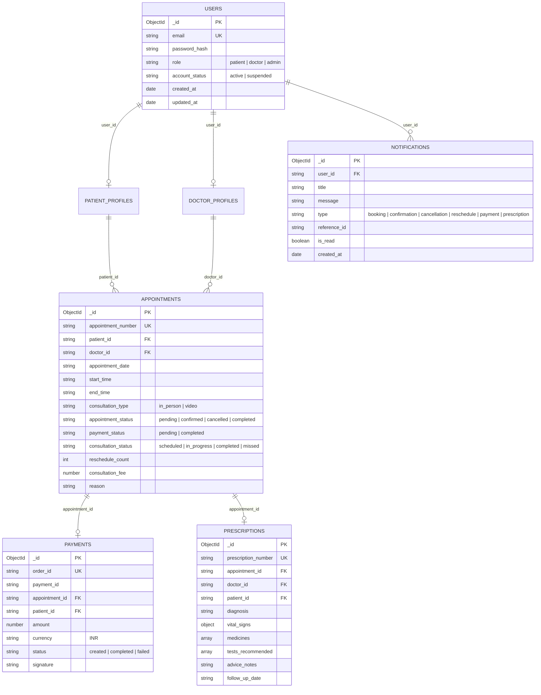

# Database Schema & Data Models (Phase V1 & V2)

MediPulse utilizes **MongoDB** as its primary document database via the official **PyMongo** driver.

Database Name: `hospital_consultation_dev` (Development) / `hospital_consultation_test` (Automated Tests)

---

## 1. Document Relationships



---

## 2. Collection Schemas

### 2.1 `payments` Collection (Phase V2)
Stores Razorpay orders and cryptographically verified payment transactions.

```json
{
  "_id": {"$oid": "6721..."},
  "order_id": "order_Mabc12345678",
  "payment_id": "pay_Mdef98765432",
  "appointment_id": "6720fae99214...",
  "appointment_number": "APT-20261029-A4B92E",
  "patient_id": "6720fae99215...",
  "doctor_id": "6720fae99214...",
  "amount": 750.0,
  "amount_paise": 75000,
  "currency": "INR",
  "status": "completed", // "created" | "completed" | "failed"
  "method": "razorpay",
  "receipt": "rcpt_APT-20261029-A4B92E",
  "signature": "e3b0c44298fc1c149afbf4c8996fb92427ae41e4649b934ca495991b7852b855",
  "error_reason": null,
  "created_at": {"$date": "2026-10-29T10:00:00Z"},
  "updated_at": {"$date": "2026-10-29T10:01:00Z"}
}
```

**Indexes**:
- `{"order_id": 1}` — Unique constraint.
- `{"payment_id": 1}`
- `{"appointment_id": 1}`
- `{"patient_id": 1}`
- `{"status": 1}`

---

### 2.2 `prescriptions` Collection (Phase V2)
Stores official medical prescriptions issued by consulting doctors.

```json
{
  "_id": {"$oid": "6722..."},
  "prescription_number": "RX-20261029-8FA2B1",
  "appointment_id": "6720fae99214...",
  "appointment_number": "APT-20261029-A4B92E",
  "doctor_id": "6720fae99214...",
  "doctor_name": "Dr. Sarah Jenkins",
  "doctor_specialization": "Cardiology",
  "doctor_qualification": "MD, DM (Cardiology), FACC",
  "doctor_license": "MCI-CARD-2012-9981",
  "patient_id": "6720fae99215...",
  "patient_name": "Jane Doe",
  "patient_gender": "Female",
  "patient_dob": "1994-06-15",
  "diagnosis": "Essential Hypertension Stage 1",
  "vital_signs": {
    "blood_pressure": "135/85",
    "pulse": "74 bpm",
    "weight": "68 kg",
    "temperature": "98.6 F"
  },
  "medicines": [
    {
      "name": "Telmisartan",
      "dosage": "40 mg",
      "frequency": "Once daily (Morning after breakfast)",
      "duration": "30 days",
      "instructions": "Avoid grapefruit juice, monitor BP weekly"
    }
  ],
  "tests_recommended": [
    "Lipid Profile",
    "Serum Electrolytes"
  ],
  "advice_notes": "Low sodium diet, 30 min daily aerobic exercise, avoid smoking.",
  "follow_up_date": "2026-11-29",
  "created_at": {"$date": "2026-10-29T10:15:00Z"},
  "updated_at": {"$date": "2026-10-29T10:15:00Z"}
}
```

**Indexes**:
- `{"prescription_number": 1}` — Unique constraint.
- `{"appointment_id": 1}`
- `{"patient_id": 1}`
- `{"doctor_id": 1}`

---

### 2.3 `notifications` Collection (Phase V2)
Stores user notifications with in-app read/unread status.

```json
{
  "_id": {"$oid": "6723..."},
  "user_id": "6720fae99215...",
  "title": "Payment Successful",
  "message": "Payment of ₹750 for appointment APT-20261029-A4B92E was successfully processed.",
  "type": "payment", // "booking" | "confirmation" | "cancellation" | "reschedule" | "payment" | "prescription"
  "reference_id": "6720fae99214...",
  "is_read": false,
  "created_at": {"$date": "2026-10-29T10:01:00Z"},
  "read_at": null
}
```

**Indexes**:
- `{"user_id": 1, "created_at": -1}`
- `{"user_id": 1, "is_read": 1}`

---

### 2.4 `appointments` Collection (Updated for Phase V2)
- Added `consultation_status`: `"scheduled"` | `"in_progress"` | `"completed"` | `"missed"`.
- Added `reschedule_count`: integer tracking reschedule iterations.
- Added `razorpay_order_id` and `razorpay_payment_id`.
- Partial unique compound index on `(doctor_id, appointment_date, start_time)` strictly preventing double bookings.
