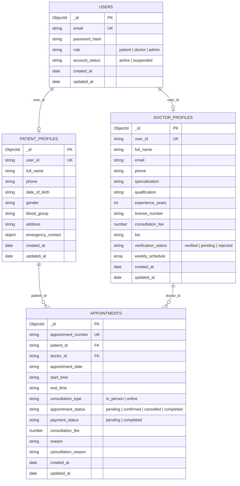

# Database Schema & Data Models (Phase V1)

MediPulse utilizes **MongoDB** as its primary document database via the official **PyMongo** driver.

Database Name: `hospital_consultation_dev` (Development) / `hospital_consultation_test` (Automated Tests)

---

## 1. Document Relationships



---

## 2. Collection Schemas

### 2.1 `users` Collection
Stores authentication credentials and high-level role information.

```json
{
  "_id": {"$oid": "6720..."},
  "email": "sarah.jenkins@medicare.com",
  "password_hash": "$2b$12$...",
  "role": "doctor", // "patient" | "doctor" | "admin"
  "account_status": "active", // "active" | "suspended"
  "created_at": {"$date": "2026-10-28T10:00:00Z"},
  "updated_at": {"$date": "2026-10-28T10:00:00Z"}
}
```

**Indexes**:
- `{"email": 1}` — Unique constraint preventing duplicate user registrations.

---

### 2.2 `doctor_profiles` Collection
Stores professional credentials, verification state, consultation fee (in INR ₹), and weekly working hours.

```json
{
  "_id": {"$oid": "6720..."},
  "user_id": "6720fae99214...",
  "full_name": "Dr. Sarah Jenkins",
  "email": "sarah.jenkins@medicare.com",
  "phone": "+91 98765 43210",
  "specialization": "Cardiology",
  "qualification": "MD, DM (Cardiology), FACC",
  "experience_years": 14,
  "license_number": "MCI-CARD-2012-9981",
  "consultation_fee": 800.0,
  "bio": "Senior Consultant Cardiologist specializing in preventive cardiology and heart failure.",
  "verification_status": "verified", // "verified" | "pending" | "rejected"
  "verified_at": {"$date": "2026-10-28T10:00:00Z"},
  "rejection_reason": null,
  "weekly_schedule": [
    {
      "day_of_week": 1, // 0=Sunday, 1=Monday ... 6=Saturday
      "is_available": true,
      "start_time": "09:00",
      "end_time": "17:00",
      "slot_duration_minutes": 30,
      "break_start": "13:00",
      "break_end": "14:00"
    }
  ],
  "created_at": {"$date": "2026-10-28T10:00:00Z"},
  "updated_at": {"$date": "2026-10-28T10:00:00Z"}
}
```

**Indexes**:
- `{"user_id": 1}` — Unique index linking 1:1 with `users._id`.
- `{"verification_status": 1}` — Index for fast filtering of approved doctors for public search.
- `{"specialization": 1}` — Index for category-based doctor search.

---

### 2.3 `patient_profiles` Collection
Stores patient personal details, contact information, and medical background metadata.

```json
{
  "_id": {"$oid": "6720..."},
  "user_id": "6720fae99215...",
  "full_name": "Rahul Verma",
  "phone": "+91 98111 22233",
  "date_of_birth": "1994-06-15",
  "gender": "male", // "male" | "female" | "other"
  "blood_group": "O+",
  "address": "42 Park Avenue, Connaught Place, New Delhi",
  "emergency_contact": {
    "name": "Priya Verma",
    "relationship": "Spouse",
    "phone": "+91 98111 22234"
  },
  "created_at": {"$date": "2026-10-28T10:00:00Z"},
  "updated_at": {"$date": "2026-10-28T10:00:00Z"}
}
```

**Indexes**:
- `{"user_id": 1}` — Unique index linking 1:1 with `users._id`.

---

### 2.4 `appointments` Collection
Stores consultation appointments with strict concurrency protection.

```json
{
  "_id": {"$oid": "6720..."},
  "appointment_number": "APT-20261028-A4B92E",
  "patient_id": "6720fae99215...",
  "doctor_id": "6720fae99214...",
  "appointment_date": "2026-11-05", // YYYY-MM-DD
  "start_time": "10:00", // HH:MM
  "end_time": "10:30", // HH:MM
  "consultation_type": "in_person", // "in_person" | "online"
  "appointment_status": "confirmed", // "pending" | "confirmed" | "cancelled" | "completed"
  "payment_status": "pending", // "pending" | "completed"
  "consultation_fee": 800.0,
  "reason": "Routine annual cardiovascular evaluation and ECG check.",
  "cancellation_reason": null,
  "cancelled_by": null,
  "cancelled_at": null,
  "created_at": {"$date": "2026-10-28T10:00:00Z"},
  "updated_at": {"$date": "2026-10-28T10:00:00Z"}
}
```

**Indexes**:
- `{"appointment_number": 1}` — Unique index for fast lookups by appointment code.
- `{"patient_id": 1, "appointment_date": -1}` — Index for patient appointment history queries.
- `{"doctor_id": 1, "appointment_date": -1}` — Index for doctor consultation schedule queries.
- **Partial Unique Compound Index**:
  ```python
  keys = [
      ("doctor_id", 1),
      ("appointment_date", 1),
      ("start_time", 1)
  ]
  unique = True
  partialFilterExpression = {
      "appointment_status": {"$in": ["pending", "confirmed"]}
  }
  ```
  Guarantees that no two non-cancelled appointments can occupy the same doctor slot simultaneously.
